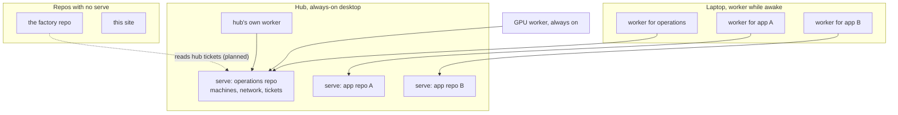

The hub on [my tailnet](/blog/tailnet) runs
[swamp](https://github.com/swamp-club/swamp) for more than one repository. A
`swamp serve` holds one repository's data, and a serve can't host several
repositories yet. So the hub runs one serve per repository, side by side, and
every machine that works for a repository runs a worker for that serve. Device
names, repository names, the tailnet domain and ports are left out on purpose.

A solid arrow is a worker dialing out to the one serve it works for. The dotted
one is planned.

## How it fits together

- **Parallel serves, not one serve fanning out.** Each serve is its own
  process with its own port, its own repository checkout on the hub and its own
  data. The serves don't share runs, data or approvals.
- **A worker belongs to one serve.** A worker connects to a single serve and
  runs the steps that serve places on it by label, such as `gpu: true` or
  `agent: claude`. A machine that works for three repositories runs three
  workers. Today the laptop does that; the GPU worker and the hub's own worker
  serve only the operations repository.
- **Each serve has its own identities.** A machine's token for one serve means
  nothing to another. On the operations serve, each machine has its own
  identity with a 7-day token rotated every 3 days. It may read workflows and
  data and start the `request-*` intake workflows (file a ticket, ask for an
  agent run, ask for time-boxed access). It may not run anything else, read a
  vault or approve its own request.
- **Intake is on the operations serve.** Machines ask the hub for things
  through that one serve. An agent run that can write, or access beyond
  read-only, waits for a person's approval.
- **Some repositories have no serve.** The factory that builds and reviews my
  apps, and this site, run swamp locally on the laptop. The hub runs none of the
  factory's work; it only keeps the factory's swamp version current. This
  site's delivery does run on the operations serve:
  nightly it merges dependency updates whose checks pass, and it checks the
  production deployment. A planned link lets the factory's tickets refer to the
  hub's tickets through the operations serve, with a read-only token of its
  own.
