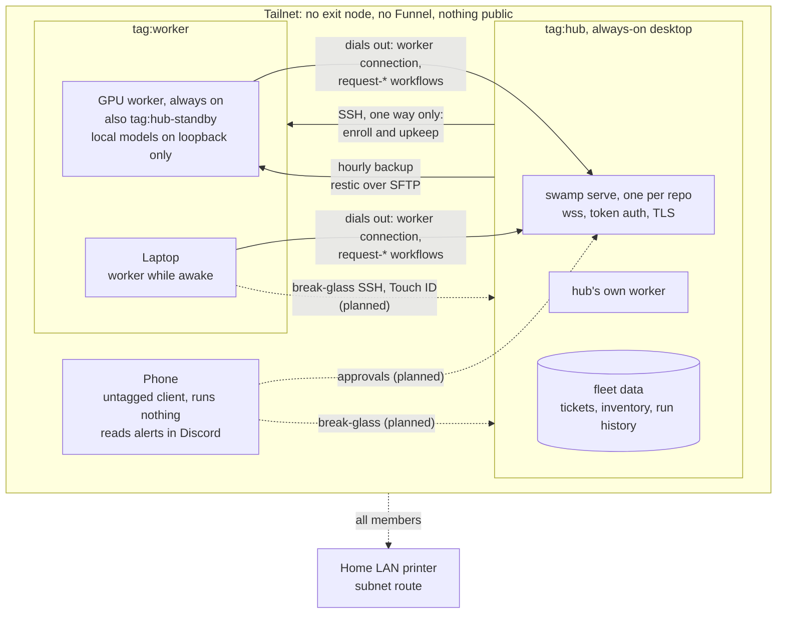

How the machines on my home tailnet work together. One always-on hub runs
[swamp](https://github.com/swamp-club/swamp) and coordinates work. The other
machines are workers that dial out to it. Device names, the tailnet domain and
addresses are left out on purpose.

## How it fits together

- **Workers dial out.** Every machine that does work runs a swamp worker that
  connects to the hub's serve and runs the steps placed on it by label, such as
  `gpu: true` or `agent: claude`. Workers hold no credentials and no
  repository; secrets resolve on the hub. So a worker needs no open inbound
  port, and workers never talk to each other directly: one step writes data, the
  next reads it through the hub.
- **Machines ask, they don't act.** Each worker machine has its own swamp
  identity with a 7-day token rotated every 3 days. It may read workflows,
  behaviors and data, and start `request-*` intake workflows (file a ticket,
  ask for an agent run, ask for time-boxed access). A ticket is filed at once,
  up to 10 a day per machine. An agent run that can write, or access beyond
  read-only, waits for a person's approval, posted to Discord.
- **SSH goes one way.** The hub reaches the workers over SSH to enroll and
  update them. Nothing reaches the hub over SSH, because agents run on the
  workers and a path into the hub would be a path to its vault. A break-glass
  path for my own laptop and phone is planned, with each key needing Touch ID
  or Face ID.
- **Nothing is on the internet.** No Tailscale Funnel and no exit node. The
  serve is reached only inside the tailnet.
- **A warm standby.** The GPU worker keeps an hourly backup of the hub's data,
  and can be promoted if the hub is gone for a while.

## Access policy

The tailnet policy is code in a repository, changed only by pull request and
validated with the policy file's own tests. Roles are Tailscale tags, so rules
name a role, never a device.

**Today** the policy still allows every device to reach every port, Tailscale's
default. What is live: the hub and worker tags, who may assign them, and two tests that
workers reach the hub's serve and the hub reaches the workers over SSH.

**The target** narrows it to this, with negative tests added alongside (for
example, a worker can't SSH to the hub):

- A person's own untagged devices reach everything.
- `tag:worker` reaches `tag:hub` on the serve ports only.
- `tag:hub` reaches `tag:worker` over SSH, for enrollment and upkeep.
- Everyone reaches the printer subnet route, as today.
